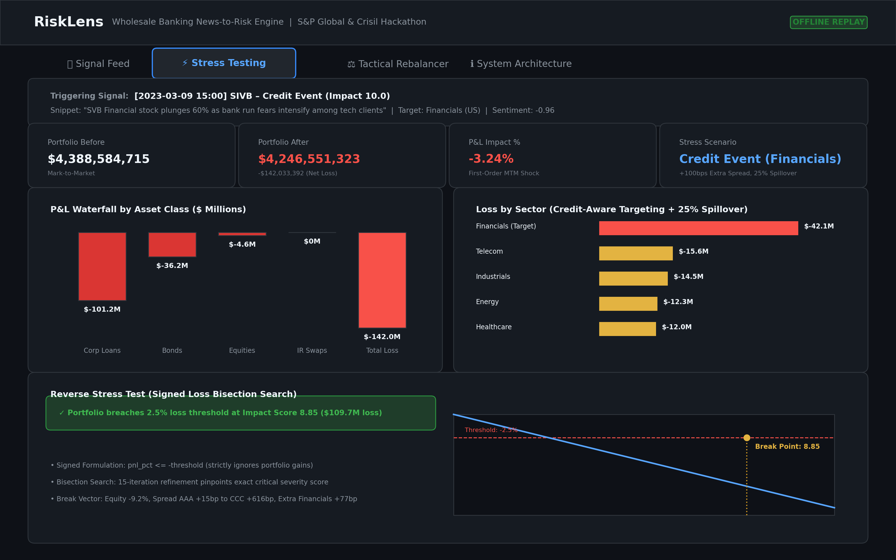

# RiskLens – Explainable News-to-Risk Engine with Wholesale Banking Stress Testing

**Candidate Name:** Garvit Audichya  
**College Email ID:** garvitaudichya010@gmail.com  
**College / Campus:** `[TODO: human to fill]`  
**Demo Video Link:** `[TODO: human to fill]`  
**Slide Deck Link:** [docs/presentation.pdf](docs/presentation.pdf)  

> **Disclaimer:** Unrelated to the commercial FAIR-based cyber-risk product of the same name.

---

## 1. Project Overview & Approach

**RiskLens** is an explainable, auditable News-to-Risk intelligence platform built for wholesale banking risk teams. Unstructured textual feeds (financial news and market social commentary) are ingested, cleaned, and processed through a domain-specific multi-stage NLP pipeline. Every signal emitted includes:
- **Domain-informed sentiment scoring** (FinBERT domain transformer with VADER rule-based fallback).
- **Taxonomy event classification** (11 wholesale banking risk types via MiniLM embeddings + logistic regression + keyword rules).
- **Auditable impact severity score (1–10)** derived with explicit multiplicative attribution across base event severity, sentiment intensity, source credibility, novelty decay, and corroboration boosts.

The core signal engine simultaneously drives two downstream modules:
1. **Module B (Strategic Wholesale Stress Testing):** When high-impact events occur, auto-triggers a credit-aware stress revaluation across a 300-position wholesale portfolio (corporate loans, bonds, equities, interest rate swaps). Applies sector-specific spread and PD shocks with documented spillover to non-target sectors, and runs a signed reverse stress test to pinpoint breaking thresholds.
2. **Module A (Tactical Index Rebalancer):** Tracks smoothed exponential sentiment across a 15-stock S&P 100 universe, tilting weights away from distressed names and toward defensive quality under strict bounds and turnover constraints.

The entire system operates **100% offline with zero external API key requirements**, loading local model weights from `.model_cache/` and deterministic replay signals.

---

## 2. Architecture & Data Flow

```
[DATA INGESTION]          [NORMALIZATION]           [NLP RISK ENGINE]          [API & DISTRIBUTION]
 SVB Replay News    ──┐    Language Filter (EN)      Entity Linking (S&P 100)   JSONL Signal Cache
 SVB Replay Social  ──┼──> Exact Hash Dedup     ──>  FinBERT (CUDA fp16)    ──> FastAPI (/signals)
 CNBC News (sample) ──┤    RapidFuzz Similarity      MiniLM Event Classifier           │
 Stock Tweets(sample)─┘    Novelty Exponential       Auditable Impact Formula          ├──> Module B: Stress Testing
                           Decay Window              (Base × Sent × Cred × Corr)       └──> Module A: Rebalancer
```

- **Environment & Runtime:** Python 3.11 / 3.12 on **Windows 11**
- **Hardware Acceleration:** NVIDIA GeForce GTX 1650 Ti (4GB VRAM, CUDA fp16) with automated CPU fallback
- **Core Frameworks:** PyTorch, Transformers, Sentence-Transformers, Scikit-Learn, FastAPI, Streamlit, Plotly, Pandas, NumPy

See [docs/architecture.png](docs/architecture.png) for the full high-resolution diagram.

---

## 3. Shipped Repositories & Datasets

Every dataset claimed in this repository corresponds directly to local files in `/data`:

| Dataset | Source / Description | Status in Repository | Shipped Location |
|---|---|---|---|
| **SVB Collapse Replay** | Curated chronological headlines & tweets (March 8–21, 2023) | **Shipped in repo** (30 documents: 19 news, 11 social) | `data/raw_samples/replay_svb.jsonl` |
| **Financial PhraseBank** | Official 100% annotator agreement subset (Malo et al.) | **Shipped in repo** (2,264 sentences) | `data/raw_samples/phrasebank.csv` |
| **Sentiment Eval Sample** | Curated financial headline sample with ground truth | **Shipped in repo** (60 sentences, 95% CI ±6 pp) | `data/raw_samples/sentiment_sample_n60.csv` |
| **Event Classification** | Curated banking distress & corporate headlines (11 classes) | **Shipped in repo** (67 headlines, out-of-fold CV) | `data/labeled_eval/labels.csv` |
| **Financial News Sample** | Sampled CNBC market headlines subset | **Shipped in repo** (500 headlines) | `data/raw_samples/news.csv` |
| **Stock Tweets Sample** | Sampled stock market tweets subset | **Shipped in repo** (300 tweets) | `data/raw_samples/tweets.csv` |
| **Wholesale Portfolio** | Synthetic corporate loans, bonds, swaps, equities (seed 42) | **Shipped in repo** (300 positions, ~$4.39B MTM) | `data/portfolio/portfolio.csv` |
| **Scenario Shock Library** | Domain-informed rating spread widening & PD multipliers | **Shipped in repo** (11 wholesale risk scenarios) | `data/scenarios/scenarios.yaml` |
| **Historical Price Cache** | Daily stock prices for 25 tickers (AAPL, TSLA, SIVB, etc.) | **Shipped in repo** (offline backtesting ready) | `data/raw_samples/prices/` |
| **Precomputed Signals** | Fully computed neural signals for instant replay | **Shipped in repo** (820 signals: 30 SVB replay [19 news, 11 social], 496 CNBC news, 294 stock tweets) | `data/output/signals.jsonl` |

> [!NOTE]
> All portfolio positions are synthetic with a fixed seed (seed 42). No proprietary S&P Global, Crisil, or client data is used. See [data/README.md](data/README.md) for full integrity statements.

---

## 4. Quickstart & Installation

```bash
# Clone the repository (or your <college>-garvit-audichya-hackathon fork)
git clone https://github.com/garvit-010/RiskLens.git
cd RiskLens

# Install required dependencies
pip install -r requirements.txt

# Run the complete system in deterministic replay mode (no API keys, zero network needed)
python run.py
```

This launches the **FastAPI REST API** on port `8000` and the interactive **Streamlit Dashboard** on port `8501`.

```bash
# Alternative execution modes:
python run.py --live            # On-the-fly neural inference on incoming text
python run.py --dashboard-only  # Streamlit UI (opens Executive Cockpit by default with deep-dive tabs)
python run.py --unified-only    # Standalone single-page Executive Cockpit for stakeholders
python run.py --api-only        # Headless FastAPI signal server only
python -m src.eval.run_eval     # Run empirical model benchmark evaluation
```

---

## 5. Key Results & Empirical Findings

### A. Model Performance & Benchmarks (from `docs/results.md`)

| Task / Benchmark | Model / Mapping | Metric | Baseline Comparison | Empirical Notes |
|---|---|---|---|---|
| **Sentiment (Argmax)** | **ProsusAI/finbert** (fp16) | **97.2% Accuracy**<br>**0.963 Macro-F1** | VADER (Rule Baseline):<br>57.1% Accuracy, 0.487 F1 | Standard academic argmax mapping (`max(pos, neg, neu)`). Negative Class: FinBERT **0.984 Recall / 0.943 F1**. |
| **Sentiment (Threshold)** | **ProsusAI/finbert** (Engine) | **87.6% Accuracy**<br>**0.876 Macro-F1** | VADER (Rule Baseline):<br>57.1% Accuracy, 0.487 F1 | Continuous net score ($P(pos) - P(neg)$, threshold $\pm 0.1$), **used in engine** for shock scaling. Negative Recall: **0.987**. |
| **Event Classification** | **MiniLM-L6-v2 + LR** (Hybrid) | **0.679 Macro-F1**<br>(Credit Event F1: **0.923**) | Keyword Baseline:<br>0.679 Macro-F1 | Evaluated via **Stratified Cross-Validation** on out-of-fold data ($n=67$). At n=67 the embedding classifier adds no measurable gain over keyword rules; keyword rules do most of the work. Keywords were refined while reviewing these labels, so the baseline is not fully out-of-sample. |
| **System Throughput** | FinBERT on GPU | **43.3 docs/sec** | Real-time stream capable | Benchmarked on NVIDIA GTX 1650 Ti (4GB VRAM, CUDA fp16 batched). |

> [!NOTE]
> **Sentiment Evaluation Notes & Caveats:**
> 1. **Mapping Difference & Engine Usage:** FinBERT argmax mapping achieves 97.2% accuracy / 0.963 macro-F1, whereas the engine's continuous net score threshold mapping ($P(pos) - P(neg)$ at $\pm 0.1$) achieves 87.6% accuracy / 0.876 macro-F1 because subtle sentiment tilts in neutral text shift predictions away from discrete neutral; the RiskLens engine uses the continuous net score ($[-1, 1]$) directly to scale portfolio stress shocks linearly.
> 2. **500-sample vs 2,264-sample Discrepancy:** An earlier exploratory benchmark on 500 samples scored 95.6% because taking the head slice (`df.head(500)`) had an unrepresentative proportion of unambiguous, high-conviction phrases; the full 2,264-sentence corpus covers the complete spectrum of nuanced corporate disclosures.
> 3. **Optimistic Ceiling:** `Sentences_AllAgree` is the easiest Financial PhraseBank subset (100% annotator agreement), and FinBERT was pre-trained and fine-tuned on Financial PhraseBank, so accuracy figures represent an optimistic performance ceiling.
> 4. **Date Ranges & Backtest Alignment:** News covers 2017–2020; Tweets cover Sep 2021–Sep 2022; Cached prices cover Sep 2021–Sep 2022. The Module A backtest runs strictly over the 2021–2022 tweet era. *No historical backtest is performed around SVB (March 2023) because price data ends in Sep 2022.* The SVB scenario is a curated forward synthetic stress test, and impact scores rely on transparent domain multipliers rather than March 2023 econometric event-study regressions.

### B. Module B: SVB Collapse Stress Test Revaluation

Selected primary demo trigger:
- **Headline:** *"SVB Financial stock plunges 60% as bank run fears intensify among tech clients"* (March 9, 2023, 15:00 UTC)
- **Signal:** Entity `SIVB` (Financials, US), Event Type: `Credit Event`, Impact Score: `10.0`, Sentiment: `-0.9589`.

```
Portfolio Before Shock:   $4,388,584,715  (~$4.39 Billion)
Portfolio After Shock:    $4,246,551,323  (~$4.25 Billion)
Total Portfolio Loss:     -$142,033,392   (-3.24% Net Loss)
```

- **Asset Class Breakdown:** Corporate Loans account for `-$101,244,094` (71.3% of loss) due to PD doubling and spread widening; Bonds absorb `-$36,220,596` (25.5%); Equities lose `-$4,568,702` (3.2%); Pay-fixed IR Swaps have zero rate move in a pure credit scenario (`$0`).
- **Credit-Aware Sector Targeting:** Positions in the target sector (`Financials`) absorb `-$42,104,976` loss (>2.7× higher than any other sector). Non-target sectors absorb a documented `25%` spillover fraction.
- **Signed Reverse Stress Test:** Using a 15-iteration bisection search, the portfolio breaches a 2.5% loss limit (internal risk tolerance threshold; 5% is not reached under sector-targeted shocks, and this is not a regulatory capital breach) at **Impact Score 8.85** (`-$109.7M` monetary loss). Favorable scenario moves (gains) are strictly ignored.

### C. Module A: Tactical Index Rebalancer Tilts

Replaying the 30 chronological SVB headlines automatically penalizes distressed credit exposures while reallocating capital to defensive quality:
- **Underweighted:** `SIVB` (-1.38% tilt to 5.28% weight, accumulated sentiment -1.20), `JPM` (-1.16% tilt to 5.51%, sentiment -1.00), `MS` (-1.08% tilt to 5.58%, sentiment -0.94), `GS` (-1.03% tilt to 5.64%, sentiment -0.89), `WFC` (-0.35% tilt to 6.32%, sentiment -0.40).
- **Overweighted:** Flight-to-safety deposit winner `BAC` (+1.91% tilt to 8.58% weight, accumulated sentiment +0.69); and defensive neutral megacaps (`AAPL`, `MSFT`, `GOOGL`, `AMZN`, `C`, `XOM`, `CVX`, `JNJ`, `META` at +0.34% tilt to 7.01% weight) absorbing reallocated capital.
- *Note on sentiment column:* Values reflect exponentially decayed sentiment accumulation over consecutive events (which can aggregate outside $[-1, 1]$ when multiple severe events occur before elapsed-time decay resets the EMA). Citigroup (`C`) sits at neutral baseline (+0.34% tilt) rather than false entity-matching inflation.

---

## 6. Dashboard & Visual Proof

### Stress Testing Dashboard


### Out-of-Fold Event Classifier Confusion Matrix


---

## 7. Regulatory Alignment & Domain Grounding

- **Supervisory Stress Testing:** The stress-testing module is **conceptually aligned with scenario analysis practices used in ICAAP and supervisory stress testing**, translating macro narrative shocks into granular rating-bucket spread widenings and counterparty PD migrations.
- **Reverse Stress Testing (SR 12-7):** Solves the supervisory question *"What magnitude of event causes a critical capital breach?"* using continuous bisection search.
- **Auditable Lineage:** Every stressed portfolio valuation traces directly to the underlying headline, timestamp, source credibility weight, and corroboration multiplier.

For complete mathematical definitions and simplifying assumptions, see:
- [docs/ASSUMPTIONS.md](docs/ASSUMPTIONS.md) – Transparent methodology choices and documented parameters.
- [docs/results.md](docs/results.md) – Full empirical classification reports and throughput benchmarks.
- [docs/DEMO_NOTES.md](docs/DEMO_NOTES.md) – Structured 5-minute hackathon jury walkthrough guide.
