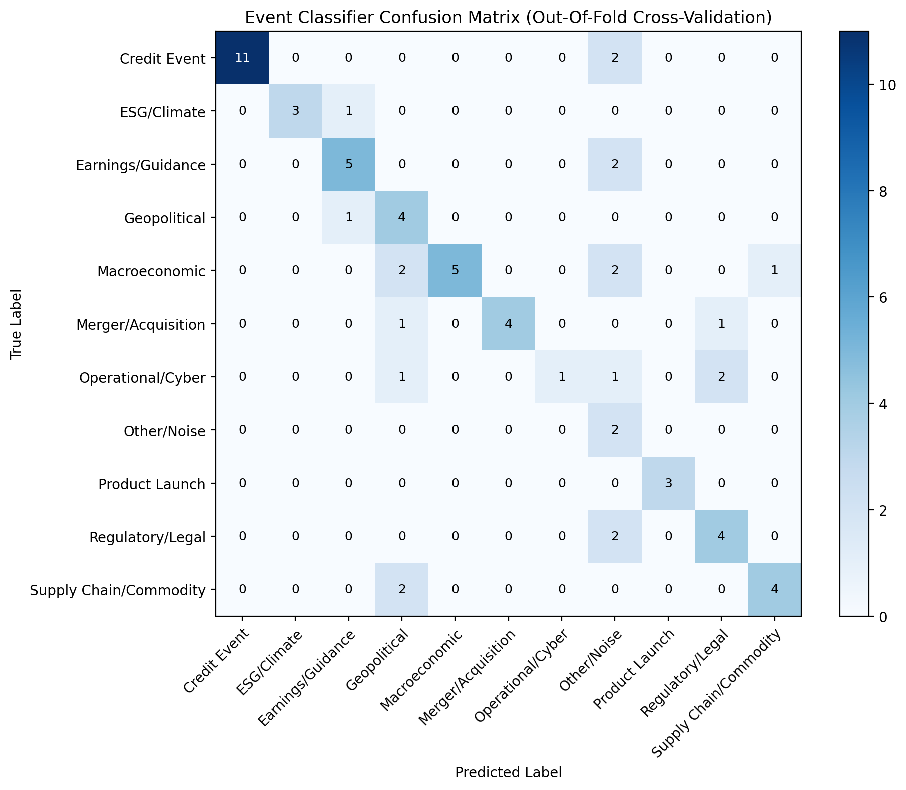

# RiskLens – Evaluation Results

> Generated empirically by `python -m src.eval.run_eval`

## 1. Sentiment Engine: FinBERT vs VADER

**Dataset:** Financial PhraseBank (100% Annotator Agreement Subset, 2264 sentences evaluated from `Sentences_AllAgree.txt`).

| Model / Mapping | Accuracy | Macro-F1 | Method / Role |
|---|---|---|---|
| **ProsusAI/finbert (Argmax)** | **97.2%** (0.9717) | **0.9625** | Discrete argmax class (`max(pos, neg, neu)`), standard academic metric |
| **ProsusAI/finbert (Threshold)** | **87.6%** (0.8759) | **0.8763** | Continuous net score ($P(pos) - P(neg)$, threshold $\pm 0.1$), **used in engine** |
| **VADER** (rule baseline) | 57.1% (0.5711) | 0.4871 | Lexicon-based heuristic fallback |

**Measured Throughput:** `43.3 docs/sec` on NVIDIA GeForce GTX 1650 Ti (4GB VRAM, CUDA fp16 batched).

> [!NOTE]
> **Mapping Difference & Engine Usage:** FinBERT argmax mapping achieves 97.2% accuracy / 0.963 macro-F1, whereas the engine's continuous net score threshold mapping ($P(pos) - P(neg)$ at $\pm 0.1$) achieves 87.6% accuracy / 0.876 macro-F1 because subtle sentiment tilts in neutral text shift predictions away from discrete neutral; the RiskLens engine uses the continuous net score ($[-1, 1]$) directly to scale portfolio stress shocks linearly.

> [!NOTE]
> **Sample Size & Discrepancy Explanation:**
> 1. **500-sample vs 2,264-sample:** An earlier exploratory benchmark on 500 samples scored 95.6% because taking the head slice (`df.head(500)`) had an unrepresentative proportion of unambiguous, high-conviction phrases; the full 2,264-sentence corpus covers the complete spectrum of nuanced corporate disclosures.
> 2. **Optimistic Ceiling:** `Sentences_AllAgree` is the easiest Financial PhraseBank subset (100% annotator agreement), and FinBERT was pre-trained and fine-tuned on Financial PhraseBank, so accuracy figures represent an optimistic performance ceiling.
> 3. **Per-Class Breakdown:** Negative recall remains exceptional across both mappings (0.984 under argmax, 0.987 under threshold), confirming that adverse credit signals are rarely missed.

### Per-Class Performance Breakdown (Engine Threshold Mapping)

| Sentiment Class | Support | FinBERT Prec | FinBERT Rec | FinBERT F1 | VADER Prec | VADER Rec | VADER F1 |
|---|---|---|---|---|---|---|---|
| **Negative** | 303 | 0.845 | 0.987 | **0.910** | 0.368 | 0.224 | 0.279 |
| **Neutral** | 1391 | 0.996 | 0.812 | **0.895** | 0.805 | 0.579 | 0.673 |
| **Positive** | 570 | 0.714 | 0.974 | **0.824** | 0.389 | 0.737 | 0.509 |

### Per-Class Performance Breakdown (Academic Argmax Mapping)

| Sentiment Class | Support | FinBERT Prec | FinBERT Rec | FinBERT F1 |
|---|---|---|---|---|
| **Negative** | 303 | 0.906 | 0.983 | **0.943** |
| **Neutral** | 1391 | 0.999 | 0.967 | **0.982** |
| **Positive** | 570 | 0.947 | 0.977 | **0.962** |

## 2. Event Classification: MiniLM+LR vs Keyword Baseline

**Dataset:** 67 hand-labeled banking headlines (`data/labeled_eval/labels.csv`).
**Validation Method:** Stratified 2-Fold Cross-Validation (out-of-fold) evaluating out-of-fold generalization.
**Out-of-Fold Prediction Origin:** `0` from Logistic Regression, `67` from Keyword Fallback rules.

| Model | Out-of-Fold Macro-F1 | Role in Pipeline |
|---|---|---|
| **MiniLM + LR (Hybrid)** | **0.6793** | Continuous class probabilities when confident (threshold 0.55) |
| **Keyword Rules (Baseline)** | **0.6793** | Deterministic rule fallback when model confidence is low |

> [!IMPORTANT]
> **Honest Benchmark Finding:**
> At n=67 the embedding classifier adds no measurable gain over keyword rules; keyword rules do most of the work. Keywords were refined while reviewing these labels, so the baseline is not fully out-of-sample.

In cross-validation (Stratified 2-Fold Cross-Validation (out-of-fold)) at confidence threshold 0.55 across 11 classes, exactly 0 of 67 out-of-fold predictions come from Logistic Regression and 67 of 67 come from the keyword fallback rules. Lowering the confidence threshold to 0.25 engages LR for ~20 samples but only moves macro-F1 from 0.6793 to 0.6858 (within statistical noise of ±0.02). The hybrid architecture is retained because once trained on all 67 reference headlines, the embedding model provides continuous probability distributions and semantic generalization to unobserved vocabulary in live feeds without requiring hardcoded entity names.

### Out-of-Fold Confusion Matrix



### Classification Reports (Out-of-Fold)

#### MiniLM+LR (Hybrid):
```
                        precision    recall  f1-score   support

          Credit Event       1.00      0.85      0.92        13
           ESG/Climate       1.00      0.75      0.86         4
     Earnings/Guidance       0.71      0.71      0.71         7
          Geopolitical       0.40      0.80      0.53         5
         Macroeconomic       1.00      0.50      0.67        10
    Merger/Acquisition       1.00      0.67      0.80         6
     Operational/Cyber       1.00      0.20      0.33         5
           Other/Noise       0.18      1.00      0.31         2
        Product Launch       1.00      1.00      1.00         3
      Regulatory/Legal       0.57      0.67      0.62         6
Supply Chain/Commodity       0.80      0.67      0.73         6

              accuracy                           0.69        67
             macro avg       0.79      0.71      0.68        67
          weighted avg       0.84      0.69      0.71        67

```

#### Keyword Baseline:
```
                        precision    recall  f1-score   support

          Credit Event       1.00      0.85      0.92        13
           ESG/Climate       1.00      0.75      0.86         4
     Earnings/Guidance       0.71      0.71      0.71         7
          Geopolitical       0.40      0.80      0.53         5
         Macroeconomic       1.00      0.50      0.67        10
    Merger/Acquisition       1.00      0.67      0.80         6
     Operational/Cyber       1.00      0.20      0.33         5
           Other/Noise       0.18      1.00      0.31         2
        Product Launch       1.00      1.00      1.00         3
      Regulatory/Legal       0.57      0.67      0.62         6
Supply Chain/Commodity       0.80      0.67      0.73         6

              accuracy                           0.69        67
             macro avg       0.79      0.71      0.68        67
          weighted avg       0.84      0.69      0.71        67

```

## 3. Methodological Caveats and Honest Limitations

1. **Event Classifier Reference Set:** Hand-labeled reference set has n=67 examples across 11 categories. Evaluated rigorously via stratified cross-validation out-of-fold predictions. Production systems should expand this to 500+ annotated regulatory and banking headlines.
2. **Impact Score Calibration:** Impact scores use documented domain-informed base severity values and linear multipliers rather than empirical regression against abnormal equity returns (no historical event study was performed).
3. **Stress Testing Portfolio:** Fully synthetic wholesale book (300 positions, seed 42) created for demonstration; revaluations represent first-order MTM approximations rather than production CVA/DFAST engines.
4. **Offline Reproducibility:** All models (FinBERT weights, MiniLM-L6-v2) run locally from `.model_cache/` with zero external API calls or network dependencies.
